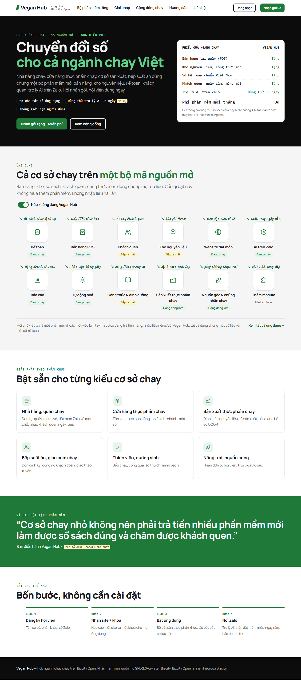
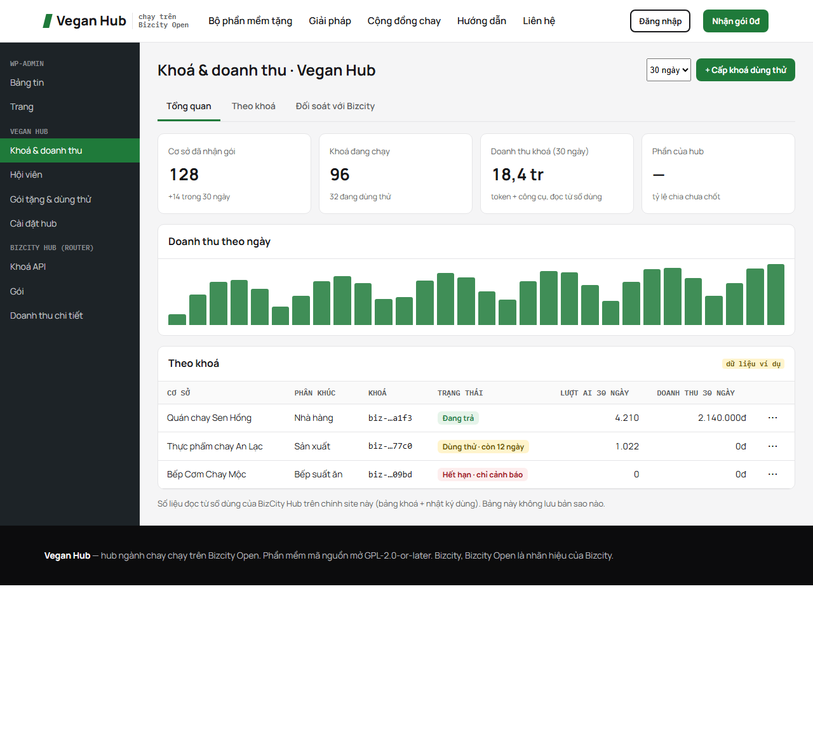
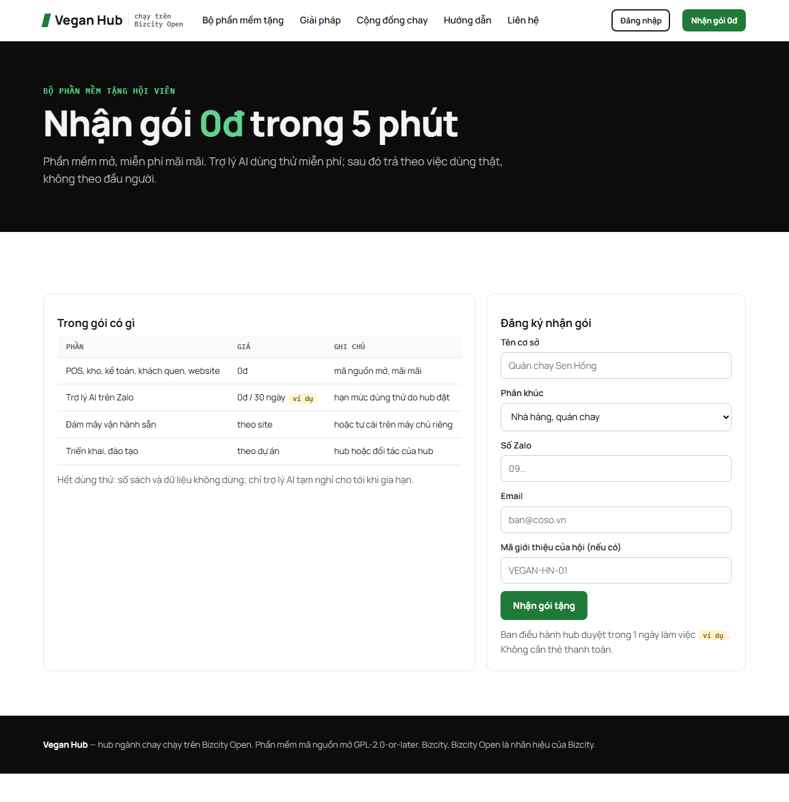
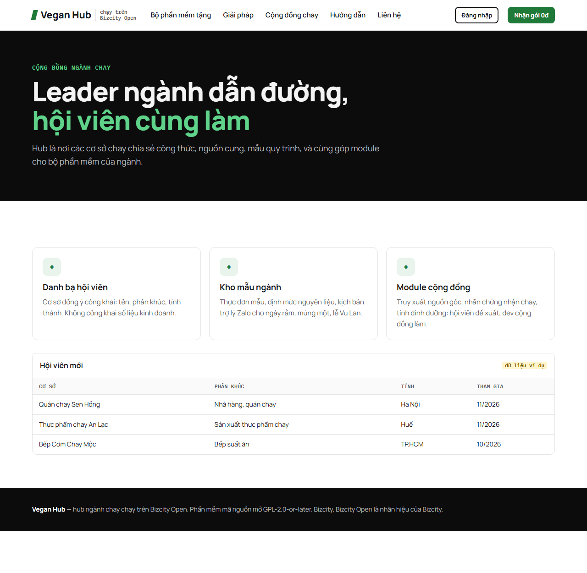
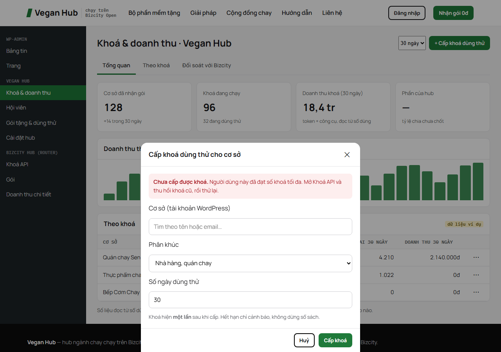
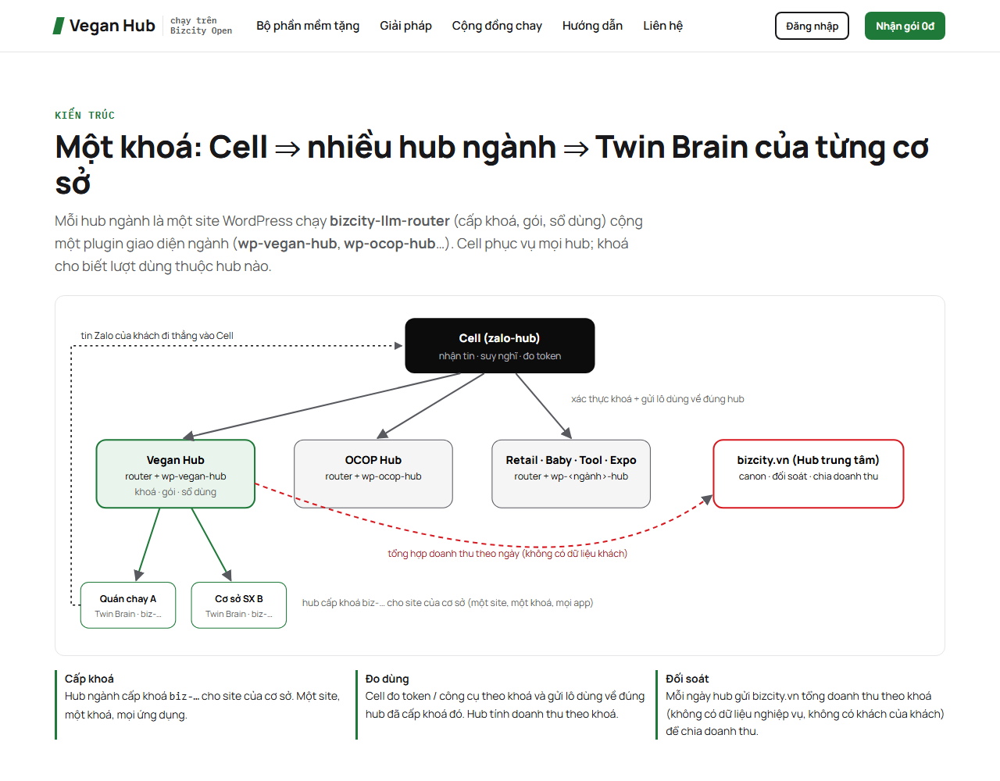

# Vegan Hub — Bizcity Open cho ngành chay

<!-- [2026-11-25 10:55 AM Johnny Chu - Chu Hoàng Anh] HUB-VEGAN V-0 — README repo wp-vegan-hub, hub ngành đầu tiên. -->

**Chuyển đổi số cho cả ngành chay Việt.** `wp-vegan-hub` là plugin WordPress dựng giao diện **hub ngành chay** trên nền Bizcity Open: tổ chức đầu ngành **tặng** nhà hàng chay, cửa hàng thực phẩm chay, cơ sở sản xuất, bếp suất ăn bộ phần mềm mã nguồn mở (bán hàng, kho, kế toán, khách quen, website, trợ lý AI trên Zalo), cho **dùng thử trợ lý AI miễn phí**, **cấp khoá** và **theo dõi doanh thu khoá** của Twin Brain.

[](LICENSE)
[](https://www.php.net/)
[](https://wordpress.org/)

[Mockup (chờ duyệt)](mockup/vegan-hub.html) · [Kiến trúc](docs/KIEN-TRUC.md) · [Checklist](docs/CHECKLIST.md) · [Lịch sử](CHANGELOG.md)

---

<!-- [2026-11-25 11:16 AM Johnny Chu - Chu Hoàng Anh] HUB-VEGAN M-2 — ảnh chụp các màn mockup (docs/shots, chụp lại bằng mockup/vegan-hub.html#scr=…&clean=1). -->

## Ảnh màn hình (mockup, chờ duyệt)

| Trang chủ hub | Bảng điều khiển của leader |
|---|---|
| [](docs/shots/01-trang-chu.png) | [](docs/shots/04-leader-doanh-thu.png) |
| **Nhận gói tặng + dùng thử** | **Cộng đồng ngành chay** |
| [](docs/shots/02-goi-tang.png) | [](docs/shots/03-cong-dong.png) |
| **Cấp khoá dùng thử (sheet, báo lỗi trong sheet)** | **Luồng một khoá: Cell ⇒ nhiều hub ⇒ Twin Brain** |
| [](docs/shots/04b-cap-khoa-sheet.png) | [](docs/shots/05-luong-mot-khoa.png) |

Trạng thái của bảng điều khiển: [trống](docs/shots/04c-trang-thai-trong.png) · [lỗi](docs/shots/04d-trang-thai-loi.png) · [không có quyền](docs/shots/04e-khong-quyen.png). Điện thoại: [trang chủ](docs/shots/06-dien-thoai-trang-chu.png) · [bảng leader](docs/shots/07-dien-thoai-leader.png).

Chụp lại sau khi sửa mockup: mở `mockup/vegan-hub.html#scr=<home|gift|community|dash|flow>&st=<empty|err|deny>&phone=1&sheet=err&clean=1` bằng trình duyệt headless (cửa sổ ≥ 520px cho bản điện thoại).

## 1. Là gì, không là gì

| Là | Không là |
|---|---|
| plugin **giao diện ngành** cắm vào `bizcity-llm-router` + open-hub | một Hub thứ hai, một bảng khoá riêng, một bộ đếm doanh thu riêng |
| nơi leader ngành cấp khoá dùng thử, xem doanh thu khoá mình cấp | nơi giữ dữ liệu kinh doanh của hội viên |
| mẫu đầu tiên cho `wp-ocop-hub`, `wp-retail-hub`, `wp-baby-hub`, `wp-tool-hub`, `wp-expo-hub` | — |

Một hub ngành = **một site WordPress chạy `bizcity-llm-router` không sửa + đúng một plugin `wp-<ngành>-hub`**. Chuẩn chung: [CHUAN-HUB-NGANH](https://github.com/hoanganh8389/open-hub/blob/main/docs/canon/CHUAN-HUB-NGANH.md) trong canon open-hub.

```text
Cell (zalo-hub) ──► Vegan Hub = bizcity-llm-router + wp-vegan-hub ──► site Twin Brain của từng cơ sở chay
                        khoá biz-… · gói · sổ dùng                     một site, một khoá, mọi app
                        └── tổng doanh thu theo khoá / ngày ──► bizcity.vn (đối soát)
```

## 2. Cài

1. Bật `bizcity-llm-router` (bản có `BizCity_Router_Industry_Hub` và open-hub `templates/v2` ≥ 2.5.3 có điểm mở rộng hub ngành).
2. Chép thư mục này vào `wp-content/plugins/wp-vegan-hub/`, bật plugin **Vegan Hub**.
3. Xem trước ở `/v2/` (chế độ preview của open-hub). Bật live theo README của open-hub.
4. wp-admin › **Vegan Hub › Cài đặt hub**: tên tổ chức leader, số ngày dùng thử.

Thiếu lõi nào, plugin không lỗi: trang quản trị báo một dòng cảnh báo.

## 3. Trang

| Đường dẫn (live) | Tệp | Mockup |
|---|---|---|
| `/` | `pages/home.php` | màn 1 |
| `/nhan-goi-tang/` | `pages/goi-tang.php` | màn 2 |
| `/cong-dong-chay/` | `pages/hoi-vien.php` | màn 3 |
| `/giai-phap/<phân-khúc>/` | khuôn `nganh.php` của open-hub, dữ liệu `data/segments.php` | — |
| wp-admin › Vegan Hub | `admin/class-vegan-hub-admin.php` | màn 4 |

Các trang còn lại (ứng dụng, giá, tự cài, nhà phát triển…) dùng nguyên trang của open-hub.

## 4. Sửa nội dung

- Chữ nằm trong `data/hub.php` và `data/segments.php`; không rải chữ trong `pages/`.
- Ghi đè không sửa tệp: `add_filter( 'wp_vegan_hub_data', function ( $d ) { $d['quote'] = '…'; return $d; } );`
- Không gõ tay số liệu đếm được; danh bạ hội viên chỉ gồm cơ sở đã đồng ý bằng văn bản.
- Chữ viết tay "Nếu không dùng Vegan Hub" mô tả cách làm chung, không nêu tên thương hiệu khác.

## 5. Làm hub ngành mới từ repo này

Chép repo, đổi `id`, tên, màu nhấn trong `data/hub.php`, thay `data/segments.php`, đổi tiền tố lớp `WP_Vegan_Hub` → `WP_<Ngành>_Hub`. Không sửa router. Xem [docs/KIEN-TRUC.md §5](docs/KIEN-TRUC.md).

## 6. Giấy phép và nhãn hiệu

Mã nguồn: [GPL-2.0-or-later](LICENSE). **Bizcity**, **Bizcity Open**, **Open Brain** là nhãn hiệu của Bizcity, không cấp theo GPL; dòng "chạy trên Bizcity Open" phải giữ.

Thiết kế và chỉ đạo: **Johnny Chu – Chu Hoàng Anh** · [bizcity.vn](https://bizcity.vn)
