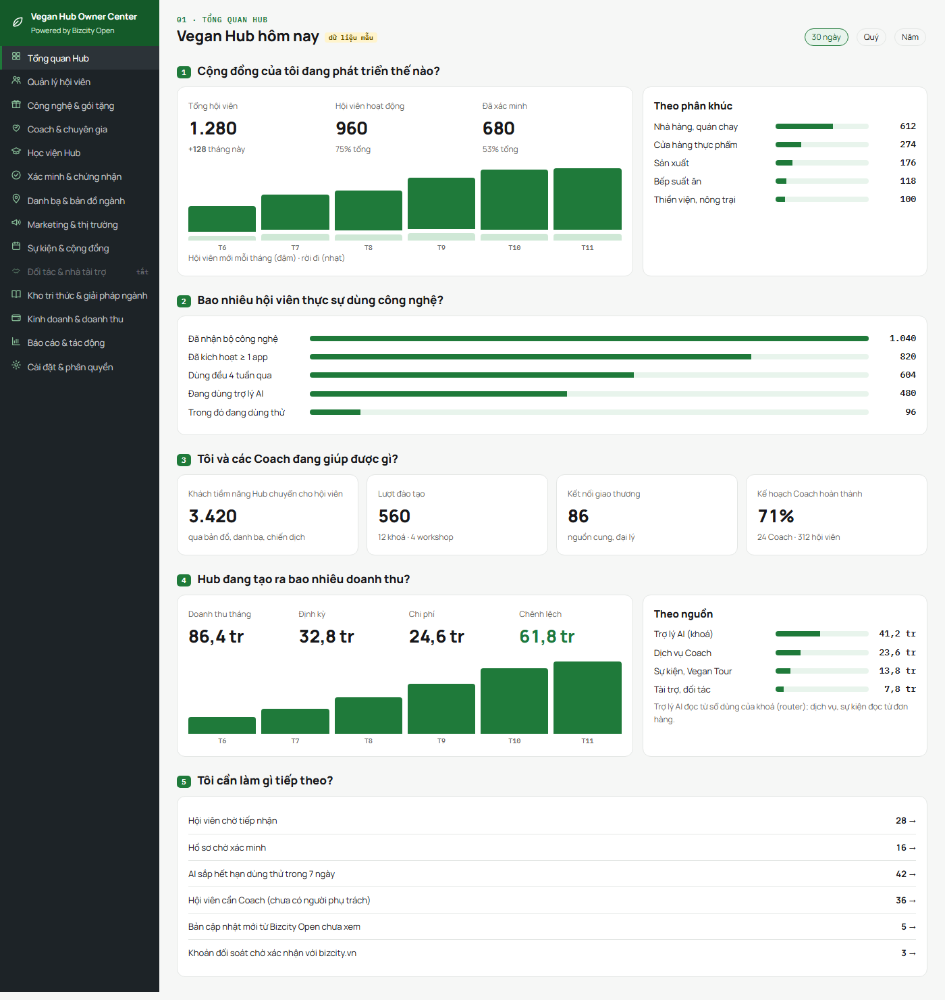
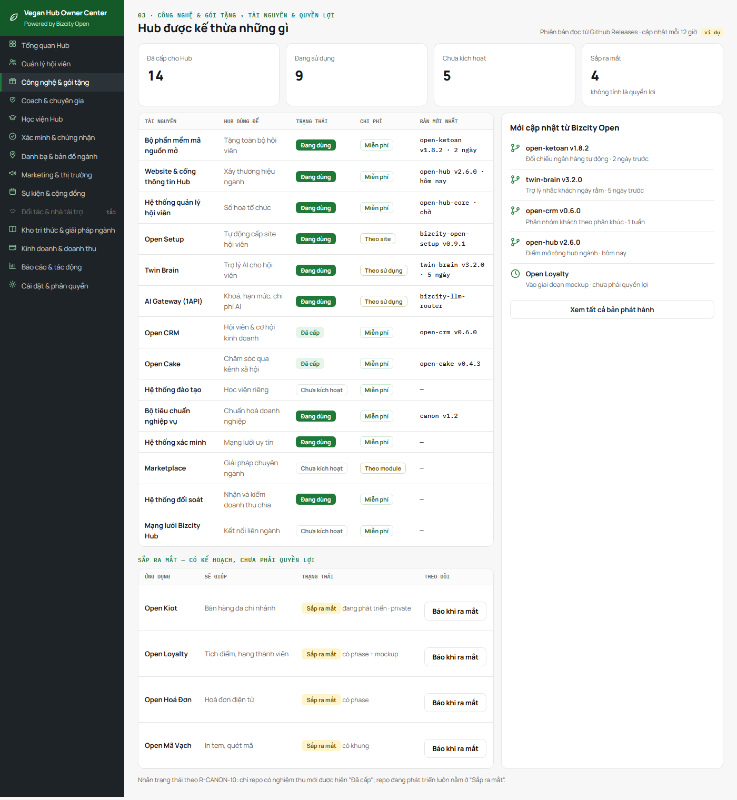
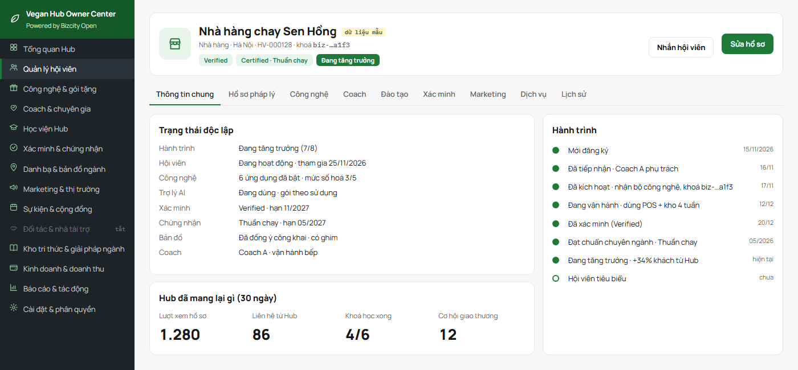
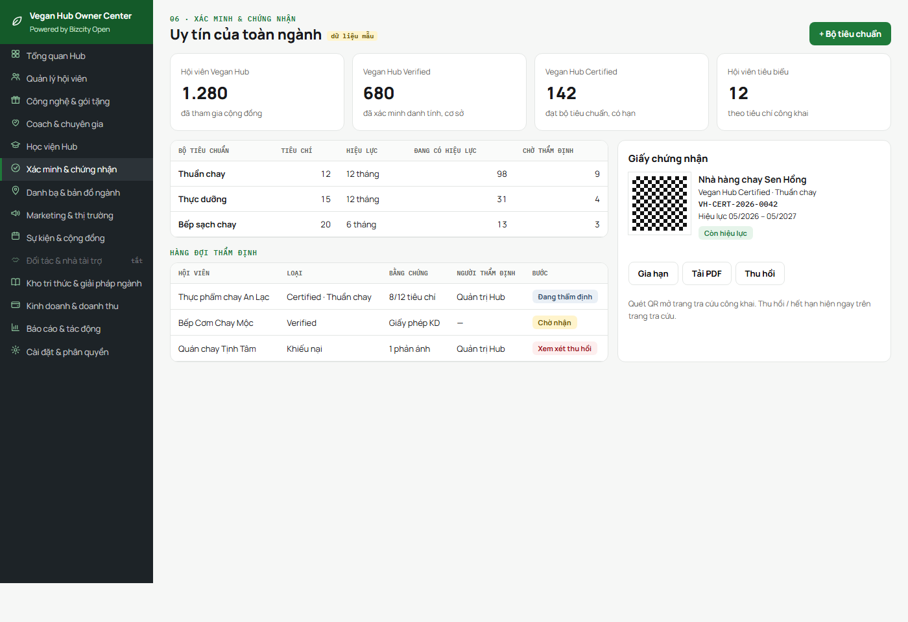
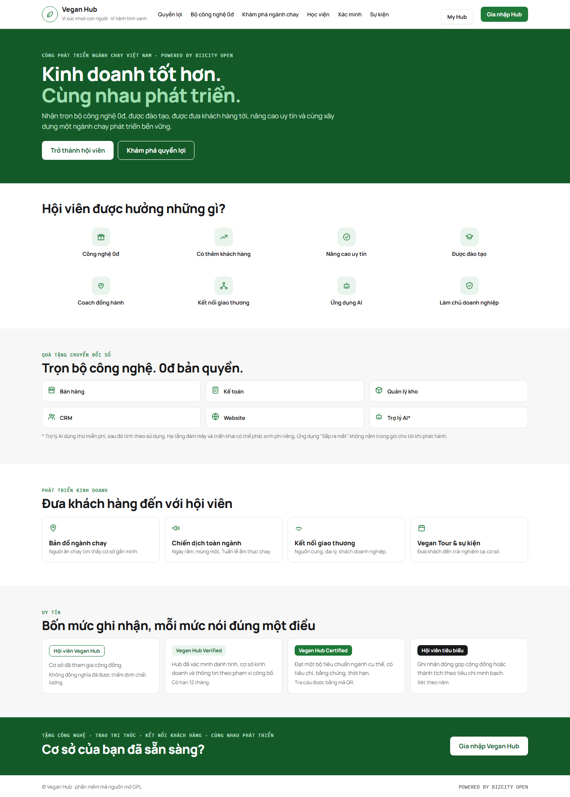
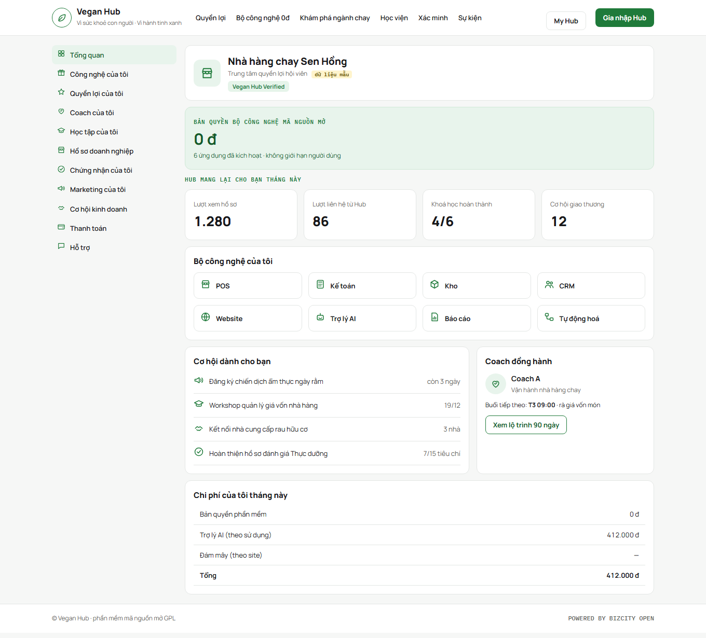

# Vegan Hub — trung tâm phát triển ngành chay Việt Nam

<!-- [2026-11-25 10:55 AM Johnny Chu - Chu Hoàng Anh] HUB-VEGAN V-0 — README repo wp-vegan-hub, hub ngành đầu tiên. -->
<!-- [2026-11-25 01:06 PM Johnny Chu - Chu Hoàng Anh] HUB-VEGAN D-1 — sắp lại README theo định vị OPEN-HUB CLIENT: Hub là trung tâm phát triển của ngành, Vegan Hub là case đầu; gom ảnh theo nhóm. -->

> **POWERED BY BIZCITY OPEN — Tặng công nghệ. Trao tri thức. Kết nối khách hàng. Cùng nhau phát triển.**

**Hub là trung tâm phát triển của một ngành. Bizcity Open là nền tảng công nghệ mà Hub kế thừa để phục vụ toàn ngành đó.** Vegan Hub không chỉ tặng phần mềm cho các quán chay: nó giúp toàn ngành chay Việt Nam kết nối, chuẩn hoá, tăng trưởng, nâng cao uy tín và chuyển đổi số.

Repo này là **case đầu tiên** để hoàn thiện một nền tảng nhân bản được cho nhiều ngành (baby, thời trang, đồ chơi, mỹ phẩm, kim khí, F&B, pharmacy, OCOP, expo, chuỗi bán lẻ…).

[](LICENSE)
[](https://www.php.net/)
[](https://wordpress.org/)

[Kiến trúc](docs/KIEN-TRUC.md) · [Cấu hình ngành chay](docs/CAU-HINH-NGANH-CHAY.md) · [Hồ sơ quyền lợi Hub (Marketing)](docs/HO-SO-QUYEN-LOI-HUB.md) · [Hồ sơ cơ sở & bản đồ](docs/HO-SO-CO-SO-BAN-DO.md) · [Checklist](docs/CHECKLIST.md) · [Lịch sử](CHANGELOG.md)

---

## 1. Repo này là gì

| Là | Không là |
|---|---|
| **gói cấu hình ngành chay**: thuật ngữ, phân khúc, bộ tiêu chuẩn, đào tạo, chuyên môn Coach, chiến dịch mẫu, trường hồ sơ, giao diện persona | mã lõi Hub (hội viên, doanh thu, Coach, chứng nhận, quyền lợi) — thứ đó thuộc **OPEN-HUB CLIENT** |
| **case đầu tiên**: mockup + shots của OPEN-HUB CLIENT được vẽ ở đây với dữ liệu ngành chay | bảng khoá, bộ đếm doanh thu riêng, dữ liệu kinh doanh của hội viên |

<!-- [2026-11-25 01:26 PM Johnny Chu - Chu Hoàng Anh] HUB-VEGAN D-4 — OH-Q1. -->
```text
bizcity.vn:    open-hub-core   (khoá 1API mọi Hub · gói · doanh thu khoá · chia · hoa hồng · đối soát)
                  ▲ API có chữ ký Hub
Site Vegan Hub: open-hub-client (14 module chung)  +  wp-vegan-hub (cấu hình ngành chay)
```

Chuẩn chung ở canon open-hub: [OPEN-HUB-CORE](https://github.com/hoanganh8389/open-hub/blob/main/docs/canon/OPEN-HUB-CORE.md) (lõi trung tâm: khoá, gói, doanh thu, hoa hồng) · [OPEN-HUB-CLIENT](https://github.com/hoanganh8389/open-hub/blob/main/docs/canon/OPEN-HUB-CLIENT.md) (định vị, vai trò repo, 14 module, bộ shots bắt buộc) · [CHUAN-HUB-NGANH](https://github.com/hoanganh8389/open-hub/blob/main/docs/canon/CHUAN-HUB-NGANH.md) (luật R-HUB, luồng một khoá) · [CHUAN-HO-SO-CO-SO-BAN-DO](https://github.com/hoanganh8389/open-hub/blob/main/docs/canon/CHUAN-HO-SO-CO-SO-BAN-DO.md).

## 2. Ảnh màn hình

Tất cả là **mockup với dữ liệu mẫu**, chưa phải ảnh WordPress thật. Chụp lại: mở `mockup/<tệp>.html#scr=<màn>&phone=1&clean=1` bằng trình duyệt headless.

### 2.1 Hub Owner Center — OPEN-HUB CLIENT (chờ duyệt) · [mockup](mockup/owner-center.html)

| Tổng quan: năm câu hỏi | Tài nguyên & quyền lợi (theo GitHub) |
|---|---|
| [](docs/shots/core/o1-tong-quan-5-cau-hoi.png) | [](docs/shots/core/o2-tai-nguyen-quyen-loi.png) |
| **Member 360°** | **Xác minh & chứng nhận** |
| [](docs/shots/core/o5-member-360.png) | [](docs/shots/core/o8-xac-minh-chung-nhan.png) |

Thêm: [tuyển Coach & affiliate](docs/shots/core/o6b-tuyen-coach-affiliate.png) · [14 module bật / tắt](docs/shots/core/o0-module-chuan.png) · [tài sản cộng đồng](docs/shots/core/o3-tai-san-cong-dong.png) · [hội viên & hành trình](docs/shots/core/o4-hoi-vien-hanh-trinh.png) · [Coach Center](docs/shots/core/o6-coach-center.png) · [Marketing Center](docs/shots/core/o7-marketing-center.png) · [điện thoại](docs/shots/core/o9-dien-thoai-tong-quan.png).

### 2.2 Frontend & My Hub (chờ duyệt) · [mockup](mockup/hub-frontend.html)

| Trang chủ hub | My Hub của hội viên |
|---|---|
| [](docs/shots/frontend/f1-trang-chu-hub.png) | [](docs/shots/frontend/f5-my-hub.png) |

Thêm: [8 trụ cột quyền lợi](docs/shots/frontend/f2-quyen-loi-8-tru-cot.png) · [xác minh & tra cứu QR](docs/shots/frontend/f3-xac-minh-chung-nhan-tra-cuu.png) · [chiến dịch mang khách về](docs/shots/frontend/f4-chien-dich-mang-khach.png) · [lộ trình 90 ngày](docs/shots/frontend/f6-my-hub-lo-trinh-90-ngay.png) · [**My Coach** (hồ sơ + hoa hồng)](docs/shots/frontend/f9-my-coach-hoa-hong.png) · [trang Trở thành Coach](docs/shots/frontend/f10-tro-thanh-coach.png) · điện thoại: [trang chủ](docs/shots/frontend/f7-dien-thoai-trang-chu.png), [My Hub](docs/shots/frontend/f8-dien-thoai-my-hub.png).

### 2.3 Hồ sơ quyền lợi Hub — cho Marketing (chờ duyệt) · [mockup](mockup/hub-partner-profile.html)

[Toàn trang](docs/shots/profile/hub-profile-toan-trang.png) · [điện thoại](docs/shots/profile/hub-profile-dien-thoai.png). Nội dung: [docs/HO-SO-QUYEN-LOI-HUB.md](docs/HO-SO-QUYEN-LOI-HUB.md).

### 2.4 Khoá & doanh thu (đã duyệt 2026-11-25) · [mockup](mockup/vegan-hub.html)

[Bảng khoá & doanh thu](docs/shots/04-leader-doanh-thu.png) · [sheet cấp khoá](docs/shots/04b-cap-khoa-sheet.png) · [luồng một khoá Cell ⇒ hub ⇒ Twin Brain](docs/shots/05-luong-mot-khoa.png) · trạng thái [trống](docs/shots/04c-trang-thai-trong.png) / [lỗi](docs/shots/04d-trang-thai-loi.png) / [không quyền](docs/shots/04e-khong-quyen.png) · trang chủ bản đầu [01](docs/shots/01-trang-chu.png), [02 gói tặng](docs/shots/02-goi-tang.png), [03 cộng đồng](docs/shots/03-cong-dong.png).

### 2.5 Hồ sơ cơ sở & bản đồ (thiết kế, MAP-Q1…Q4 đã chốt) · [mockup](mockup/vegan-member-map.html)

[Admin danh sách](docs/shots/map/a1-admin-danh-sach.png) · [sheet xác minh](docs/shots/map/a2-sheet-ho-so-xac-minh.png) · [bản đồ admin](docs/shots/map/a3-admin-ban-do.png) · [bản đồ công khai](docs/shots/map/f1-ban-do-cong-khai.png) · [site hội viên tự cập nhật](docs/shots/map/s1-site-hoi-vien-tu-cap-nhat.png).

### 2.6 Persona cổng ngành chay (chờ duyệt) · [mockup](mockup/vegan-persona.html)

[Cổng ngành](docs/shots/persona/p1-trang-chu-cong-nganh.png) · [bản đồ & danh bạ](docs/shots/persona/p2-ban-do-danh-ba.png) · [hồ sơ cơ sở](docs/shots/persona/p3-ho-so-co-so.png) · [trở thành hội viên](docs/shots/persona/p4-tro-thanh-hoi-vien.png).

## 3. Mã hiện có (v0.2.0)

<!-- [2026-11-25 05:52 PM Johnny Chu - Chu Hoàng Anh] HUB-VEGAN V-10 -->
**Đường chính (có `open-hub-client`):** repo này chỉ đưa dữ liệu ngành chay theo hợp đồng `bizcity_industry_hub@2` (`data/industry.php`) + giao diện persona trên open-hub. Khoá, doanh thu, hội viên, chứng nhận nằm ở màn của `open-hub-client` và `open-hub-core`. Kiểm: `php tests/run.php` (cần `open-hub-client` nằm cạnh).

**Đường cũ (chưa có client):**

Bản khung chạy trên router + open-hub `templates/v2` hiện tại, **trước** khi có `open-hub-client`: trang chủ, nhận gói tặng, cộng đồng, 6 phân khúc, wp-admin › Vegan Hub (khoá & doanh thu, cấp khoá dùng thử, cài đặt). Khi `open-hub-client` ra đời, phần quản trị chuyển sang Core; repo này chỉ còn cấu hình. Chữ nằm trong `data/hub.php`, `data/segments.php`.

Cài: bật `bizcity-llm-router` (có `BizCity_Router_Industry_Hub`, open-hub ≥ 2.6.0) → chép thư mục vào `wp-content/plugins/wp-vegan-hub/` → bật **Vegan Hub** → xem ở `/v2/`.

## 4. Giấy phép và nhãn hiệu

Mã nguồn: [GPL-2.0-or-later](LICENSE). **Bizcity**, **Bizcity Open**, **Open Brain** là nhãn hiệu của Bizcity, không cấp theo GPL; dòng "Powered by Bizcity Open" phải giữ.

Thiết kế và chỉ đạo: **Johnny Chu – Chu Hoàng Anh** · [bizcity.vn](https://bizcity.vn)
